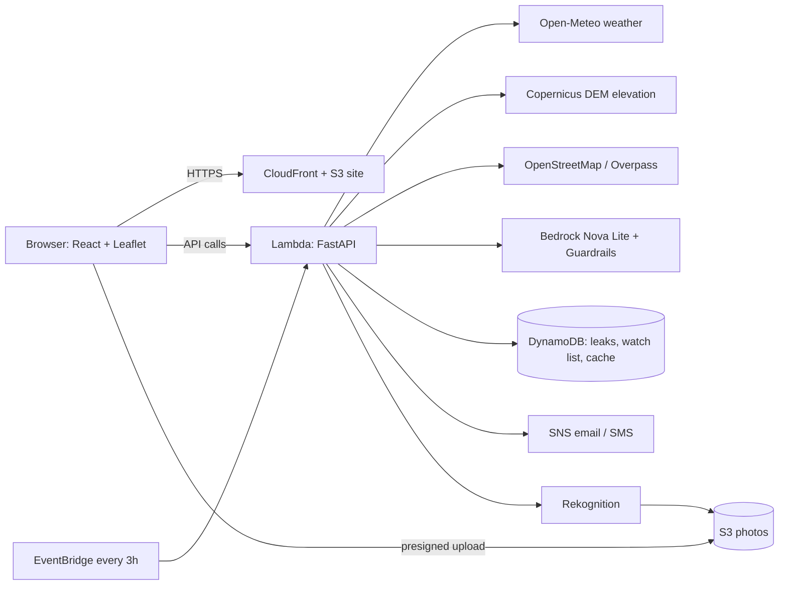

# FloodSense AI: Heat, Water and Climate Resilience for Any City

> Heatwaves, floods, droughts and every leaking pipe in between, on one map, in your language, for **any city in the world**.

Built for the **Amazon AWS Environmental Hackathon**. Pick a city (or search any town, or use your location) and FloodSense AI shows where the climate risk is highest right now, tells residents what to do in plain language, warns them by email or SMS before it gets worse, and turns citizen reports of water leaks into a repair-priority list.


---

## 1. The problem

Cities now face floods, heatwaves and water shortage in the same year, often in the same month. Warnings are regional, in one language, and say little about *which street* is at risk. Meanwhile, huge amounts of treated water leak away unreported while neighbourhoods run dry.

## 2. What FloodSense AI does

| Layer | Inputs (all free, no API key) | Output |
|---|---|---|
| **Flood** | Open-Meteo rain forecast + Copernicus DEM elevation | Risk map, hotspots, shortest vs safer route (OSMnx) |
| **Heatwave** | Open-Meteo temperature and humidity, heat index, days at 40 C+ in next 7, OpenStreetMap parks, forests and water | Risk map: spots with little green or water cover score higher |
| **Drought** | Open-Meteo: last 91 days of rain vs 10-year average, dry-spell length, evaporation | City-level drought index and weekly rain-vs-normal chart |
| **Water leaks** | Citizen reports (DynamoDB) + drought index at that spot | Map of leaks ranked by litres wasted per day, raised in priority when the area is also dry; "mark fixed" |
| **Impact tracker** | Fixed leak reports | Litres/day stopped, litres saved, tanker-trip and people-days equivalents |
| **Safe places** | OpenStreetMap hospitals, shelters, assembly points + terrain | Nearest places with distance and direction, whether they sit lower than you, nearest higher ground |
| **Photo evidence** | Leak photo uploaded from the browser to private S3 | Rekognition checks for water and a pipe/tap/hose, blocks inappropriate images, adds a "verified" badge |
| **Ask FloodSense** | Live flood/heat/drought facts, leak reports, nearby safe places | Grounded answers from Amazon Bedrock with Guardrails, rule-based fallback |
| **AI briefing** | All three hazards for the chosen place | One short briefing in the user's language, highest risk first |
| **Resilience score** | Flood + heat + drought scores | One 0-100 score with a label |
| **Early-warning alerts** | Email or SMS subscribers per ~11 km area | Alerts only when risk rises (or once a day if it stays high), in each subscriber's language |

Every hazard has a **scenario slider** (storm mm, heatwave temperature, % of normal rain) so the app can be demoed on any day. Scenarios adapt to the place: heat uses local humidity, drought uses the local 10-year normal. Alerts sent from a scenario are labelled `[SIMULATED]`.

**17 languages:** English, Hindi, Tamil, Bengali, Marathi, Telugu, Gujarati, Kannada, Malayalam, Punjabi, Urdu, Spanish, French, Portuguese, Arabic, Indonesian, Swahili.

## 3. Why it matters (environmental impact)

- **Climate adaptation:** one tool for the three hazards that hit cities hardest, with actionable advice instead of raw numbers.
- **Water conservation:** every leak is estimated in litres per day and ranked, so crews fix the biggest losses first, especially during drought. Impact is shown as tanker trips and people-days of water saved.
- **Inclusion:** advice and alerts in 17 languages, plus SMS for people without smartphones or data.
- **Works anywhere:** built only on open global data, so it is not tied to one city.

Aligned with UN SDG 6 (Clean Water), SDG 11 (Sustainable Cities) and SDG 13 (Climate Action).

## 4. Amazon Web Services used

| Service | How we use it |
|---|---|
| **AWS Lambda** (container image) + **Function URL** | Runs the FastAPI backend (via Mangum) and the scheduled monitor, with no servers to manage |
| **Amazon Bedrock** (Nova Lite) | Plain-language advisories, combined briefings, grounded Q&A, and translation of alerts into 17 languages |
| **Bedrock Guardrails** | Keeps the open-ended "Ask FloodSense" box on topic and safe: hate, violence, insults, misconduct, prompt attacks, PII anonymised |
| **Amazon DynamoDB** | Leak reports (with a grid-cell index so map queries never scan the table), the alert watch list, a shared cache for weather/drought/OpenStreetMap answers, and rate-limit counters. All with TTL auto-expiry |
| **Amazon SNS** | Email and SMS delivery, with filter policies on area, level and language so each subscriber gets only their own alerts |
| **Amazon EventBridge** | Re-checks every watched area every 3 hours and triggers alerts when risk rises |
| **Amazon Rekognition** | Checks leak photos for water and pipes, and moderates inappropriate content |
| **Amazon S3** | Private photo bucket (presigned upload, 30-day expiry) and static website hosting |
| **Amazon CloudFront** | Serves the website over HTTPS with security headers |
| **AWS SAM / CloudFormation** | The whole stack is defined in `template.yaml` and deployed with one command |

**Graceful degradation:** every AWS feature has a fallback. If Bedrock is off or unreachable, rule-based advice is returned. Without DynamoDB, SNS or S3 settings, the app runs in local mode (in-memory data, simulated alerts). The rule-based risk score is always the source of truth; AI only explains it.

## 5. Architecture



More detail in `docs/ARCHITECTURE.md` and `docs/architecture.svg`.

## 6. How the risk scores work (explainable, no black box)

- **Flood:** rainfall (24 h total and peak hourly) combined with how low-lying the spot is compared with its surroundings and how flat the terrain is (90 m Copernicus DEM). No drainage data.
- **Heat:** feels-like temperature and humidity, number of 40 C+ days in the next 7, and a green/water-cover proxy from OpenStreetMap for the urban heat effect.
- **Drought:** rainfall over the last 91 days versus the 10-year normal, length of the current dry spell, and evaporation.
- **Leaks:** litres per day by leak type (drip 20, steady 2,000, overflow 1,000, burst 50,000), scaled up when the area is also under drought stress. These are rough planning assumptions, not measurements. 135 L/person/day is the planning norm used for "people served" comparisons.
- **Resilience score:** one 0-100 number combining the three hazards.

## 7. What we built and changed (project log)

**Core application**
- FastAPI backend with 20+ endpoints and a React + Vite + Leaflet frontend.
- Flood, heatwave and drought risk engines using only free open data, with map grids, hotspots and city-level indexes.
- Flood-risk-aware routing with OSMnx: shortest route vs a route that avoids estimated high-risk roads.
- Water-leak reporting with priority ranking, "mark fixed", and an impact tracker.
- Safe-places finder (hospitals, shelters, higher ground) added to flood and heat alerts.
- Scenario sliders for flood, heat and drought so the demo works on any day.

**AWS and AI features**
- Bedrock advisories, briefings and grounded "Ask FloodSense" Q&A with Guardrails.
- 17-language support, including Bedrock translation of alerts (emails keep the English original underneath).
- Email and SMS early-warning alerts through SNS, with an EventBridge schedule re-checking every watched area.
- Photo evidence flow: browser to S3 (presigned POST) to Rekognition verification and moderation.
- One-command deployment (`deploy.sh` + `template.yaml`) for the full AWS stack.

**Safety and reliability**
- Per-IP, per-contact and per-area rate limits (DynamoDB counters), bounding-box size limits, a shared DynamoDB cache, a grid-cell index for leak queries, private S3 buckets, CORS limited to the site, security headers.
- Fallbacks everywhere so an AWS or data-source problem never breaks the app.

**Deployment update: Render support**
- Added `render.yaml` so the API and website can also deploy to Render from a GitHub repo, without an AWS account.
- Rate limiting now reads the real visitor IP from `X-Forwarded-For`, so it works behind Render's proxy.
- `ALLOWED_ORIGIN` accepts several comma-separated origins.
- `mangum` is optional (only needed on Lambda).
- Added a `/` API landing route, and the frontend tolerates a trailing slash in `VITE_API_URL`.
- AWS deployment files are unchanged and still work.

## 8. Run locally (2 terminals)

```bash
# Backend (Python 3.10+). Without LEAKS_TABLE leak reports are kept in memory.
cd backend && python -m venv .venv && source .venv/bin/activate   # Windows: .venv\Scripts\activate
pip install -r requirements.txt
USE_BEDROCK=0 uvicorn main:app --reload        # http://localhost:8000/docs  (drop USE_BEDROCK=0 if `aws configure` is done)

# Frontend (Node 18+)
cd frontend && cp .env.example .env && npm install && npm run dev      # http://localhost:5173
```

## 9. Deploy

### Option A: AWS (full feature set, one command)

Prerequisites: AWS CLI logged in (`aws configure`), [SAM CLI](https://docs.aws.amazon.com/serverless-application-model/latest/developerguide/install-sam-cli.html), Docker running, Node 18+. In the Bedrock console (us-east-1), make sure **Amazon Nova Lite** is available to your account.

```bash
./deploy.sh
```

It builds the backend as a Lambda container image, creates the Function URL, DynamoDB tables, SNS topic, EventBridge schedule, S3 buckets and Guardrail, builds the frontend pointing at the API, uploads it to S3 and serves it through CloudFront. It prints the live URL. The first deploy takes about 5 to 10 minutes (the image is large because of osmnx). Re-run the same command to update.

- Tear down: empty both S3 buckets, then `sam delete --stack-name floodsense`.
- If the Guardrail fails to deploy in your account: `sam deploy --parameter-overrides EnableGuardrail=false`.
- If the API returns 403, the account needs `lambda:InvokeFunction` for Function URLs; the template already adds it (`ApiInvokePermission`).

### Option B: Render (simplest, free, no AWS account)

1. Push this folder to a GitHub repo.
2. Render dashboard, **New, Blueprint**, select the repo. `render.yaml` creates `floodsense-api` (FastAPI) and `floodsense-web` (React site). Click Apply.
3. Copy both service URLs. Set `ALLOWED_ORIGIN` on the API to the **website URL**, and `VITE_API_URL` on the website to the **API URL** (no trailing slash).
4. On the website service, run **Manual Deploy, Clear build cache and deploy** (the frontend reads `VITE_API_URL` at build time).
5. Check `https://<api>/health` returns `{"ok": true}`, then open the website.

On Render the app runs in local mode: rule-based advice (`USE_BEDROCK=0`), in-memory leak reports and sign-ups (reset on restart), photo upload off, simulated alerts. The free tier sleeps after 15 minutes idle (first request about 30 s) and has 512 MB RAM, so safe routing may run out of memory; use the Starter plan for that. To use Bedrock from Render, set `USE_BEDROCK=1` and add AWS credentials as environment variables.

### Environment variables

| Variable | Purpose |
|---|---|
| `USE_BEDROCK` | `0` turns Bedrock off (rule-based advice) |
| `BEDROCK_MODEL_ID` | Default `amazon.nova-lite-v1:0` |
| `GUARDRAIL_ID` | Bedrock Guardrail for the Ask box |
| `LEAKS_TABLE`, `WATCH_TABLE`, `CACHE_TABLE` | DynamoDB tables |
| `ALERTS_TOPIC_ARN` | SNS topic for email/SMS |
| `PHOTO_BUCKET` | S3 bucket for leak photos |
| `ALLOWED_ORIGIN` | Website URL(s) allowed by CORS, comma separated |
| `VITE_API_URL` | (frontend, build time) API base URL |

On AWS the template sets all of these. Without them the app runs in local mode and nothing is emailed.

## 10. API

| Endpoint | Purpose |
|---|---|
| `GET /health`, `GET /` | Health check, API info |
| `GET /weather?lat=&lon=&rain_mm=` | 24 h rainfall (rain_mm > 0 simulates a storm) |
| `GET /flood-risk?lat=&lon=&rain_mm=` | Flood risk at a point |
| `GET /risk-zones?bbox=s,w,n,e&rain_mm=` | Flood risk GeoJSON grid |
| `POST /safe-route` `{start,end,rain_mm}` | Shortest vs safer route |
| `GET /heat-risk?lat=&lon=&temp_c=` | Heat risk at a point (temp_c > 0 simulates a heatwave) |
| `GET /heat-zones?bbox=s,w,n,e&temp_c=` | Heat risk GeoJSON grid |
| `GET /drought?lat=&lon=&rain_pct=` | Drought index (rain_pct > 0 simulates "% of normal rain") |
| `GET /advisory?lat=&lon=&hazard=flood\|heat\|drought&place=&lang=` | 2-3 sentence advice via Bedrock |
| `GET /briefing?lat=&lon=&place=&lang=` | Combined briefing via Bedrock |
| `POST /ask` `{question,lat,lon,place,lang,history}` | Grounded Q&A via Bedrock + Guardrails |
| `GET /leaks?bbox=` | Open leaks, summary and impact |
| `POST /leaks` | Report a leak (optional `photo_key`) |
| `POST /leaks/photo-upload` | Presigned S3 POST (one jpeg, max 4 MB, 5 min) |
| `POST /leaks/{id}/fix` | Mark a leak fixed |
| `POST /leaks-demo?lat=&lon=` | Sample leak reports around a point |
| `GET /safe-places?lat=&lon=` | Nearest hospitals, shelters, higher ground |
| `POST /alerts/subscribe` `{contact,lat,lon,place,min_level,lang}` | Subscribe an email or phone number (+country code) |
| `POST /alerts/send-now?lat=&lon=` | Demo: publish an alert for this spot now |

Interactive docs at `/docs`.

## 11. 3-minute demo script

1. Pick **Mumbai**, Flood tab, slider to **Extreme**: hotspots appear; click one, press *Get AI advisory*.
2. Click a spot, press **Find safe places nearby**. Then **Plan a route**: shortest vs safer.
3. Switch to **Jaipur**, Heatwave tab, **Severe 48 C**: spots far from parks glow red.
4. Drought tab, **Severe 30%**: rain vs 10-year average chart.
5. **Leaks** tab: *Load demo reports*, show litres lost per day, report a new leak **with a photo** (verified badge), mark one fixed.
6. **Early-warning alerts**: subscribe your email (choose Hindi), confirm the SNS email, move the slider to Extreme, press *Send an alert now*. Show **Impact so far**.
7. Language **Hindi** + **Brief me**: one briefing across all hazards.
8. Type any town in the search box to prove it is not tied to one city.

More in `docs/DEMO_SCRIPT.md` and `docs/PITCH.md`.

## 12. Responsible AI and limitations

- **Estimates only.** Not official forecasts or warnings. Follow your national weather service (IMD in India) and local authorities. Every answer says so.
- **AI explains, rules decide.** Risk levels come from transparent rules. Bedrock only writes the explanation, and the Ask box may use only the facts supplied (Guardrails on).
- Flood uses rain and 90 m terrain, with **no drainage data**.
- Heat uses a **green/water-cover proxy**, not measured surface temperature, and a simplified 40 C threshold.
- Drought is a **city-level index**, not a map, and does not see reservoir or groundwater levels.
- Litres lost per leak type are **planning assumptions**, not measurements.
- Safe places depend on OpenStreetMap coverage; community centres and schools are only *possible* shelters; higher ground is a hint from 90 m terrain and may be private land or water.
- The photo check is a **helper, not proof**; a person still decides.
- Translations come from a language model; emails include the English original.
- **SMS:** new AWS accounts are in the SNS SMS sandbox (verify your test number first). India needs DLT registration for real delivery, so use email for India demos if it is not set up. Unicode SMS (Hindi, Tamil...) is billed per 70-character segment.
- **Privacy:** contacts are hashed for rate limiting, subscriptions auto-expire after 90 days, leak data and photos after 30 days.
- The demo API is public and unauthenticated. For production add Cognito for staff, AWS WAF in front of the API, and reserved concurrency as a cost ceiling.

## 13. Roadmap

Validate against known waterlogging spots and weather-service heat records; satellite land-surface temperature for heat; reservoir levels for drought; WhatsApp alerts; cache OSM graphs on S3; a permanent database option for non-AWS hosting.

## 14. Repository structure

```
FloodSense-AI/
├── backend/               FastAPI app (main.py) + services/ (weather, flood_risk, heat_risk, drought,
│                          leaks, alerts, monitor, photos, safe_places, advisory, ask, resilience, routing, cache)
├── frontend/              React + Vite + Leaflet (App.jsx, components/, services/api.js)
├── docs/                  ARCHITECTURE.md, architecture.svg, PITCH.md, DEMO_SCRIPT.md
├── template.yaml          AWS SAM / CloudFormation stack
├── samconfig.toml         SAM defaults
├── deploy.sh              One-command AWS deploy
├── render.yaml            Render Blueprint (API + website)
└── README.md
```

## Data sources and credits

[Open-Meteo](https://open-meteo.com) (weather, climate), Copernicus DEM (elevation), [OpenStreetMap](https://www.openstreetmap.org) contributors via Overpass and OSMnx, Leaflet. Built with FastAPI, React and Vite.
