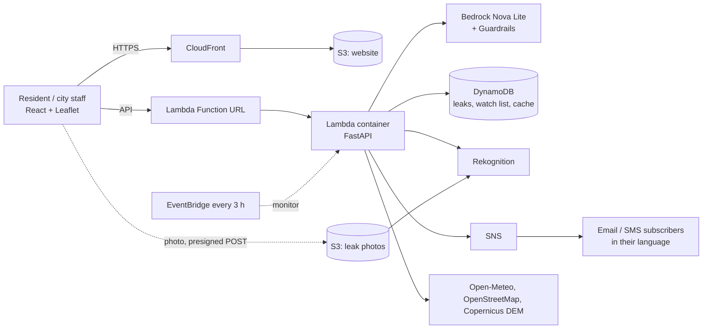

# Architecture

Picture version: `architecture.svg` (open in a browser). The same diagram as Mermaid (GitHub renders it):

## Request flows

| Flow | Path |
|---|---|
| Risk map / check a spot | Browser -> Function URL -> Lambda -> Open-Meteo (rain/heat/drought) + elevation + OSM -> rule-based score -> GeoJSON. Answers are cached in DynamoDB (shared across Lambda instances). |
| AI advice, briefing, Ask | Lambda builds a facts block from the scores -> Bedrock (Nova Lite) writes 2-4 sentences. Ask also uses a Bedrock Guardrail. If Bedrock fails, a rule-based text is returned. |
| Leak report with photo | Browser -> S3 (presigned POST, jpeg, max 4 MB) -> report saved in DynamoDB after Rekognition checks the photo (water + pipe, moderation). |
| Early warning | EventBridge (every 3 h) -> same Lambda -> for each watched area compute flood/heat/drought + safe places -> Bedrock translates per subscriber language -> SNS publishes (email full text, SMS short text) with area/level/language attributes; SNS filter policies route it. |

## Design choices worth saying out loud

- **Rule-based scores are the source of truth.** Bedrock only explains and translates them, so advice never contradicts the numbers and the app still works if Bedrock is off.
- **Everything degrades gracefully:** failed data source drops one hazard, failed Bedrock gives rule-based text, failed Rekognition keeps the report as "unchecked", failed OSM gives an alert without the safe-places lines.
- **Alerts only when risk rises** (or once a day while it stays high), so people do not learn to ignore them.
- **Cost-safe by design:** pay-per-request DynamoDB, Lambda, SNS, Rekognition and Bedrock; no servers idle; cache and rate limits cap upstream and AWS calls.

## Security and abuse controls

CORS limited to the CloudFront site, per-IP and per-contact rate limits (DynamoDB counters), a once-per-2-minutes cap per area on demo alerts, bbox size limits, private S3 buckets with 30-day expiry, presigned upload limited to one jpeg of 4 MB, Bedrock Guardrails (prompt attacks, harmful content, PII anonymised) on Ask, security headers on the site, DynamoDB encryption, least-privilege IAM per resource.
Not done yet (be honest if asked): user authentication (Cognito), AWS WAF in front of the API, reserved concurrency as a hard cost ceiling.

## How it scales

| Part | Today | Next step |
|---|---|---|
| API | Lambda scales per request | Put CloudFront in front of the API (then AWS WAF), reserved concurrency as a cost ceiling |
| Leak map | Grid-cell index (`CellIndex`) queried per map area | Same design holds to millions of reports (on-demand DynamoDB) |
| Early warning | One scheduled Lambda checks up to 25 watched areas per run | EventBridge -> SQS -> one Lambda per area (or Step Functions Map) for thousands of areas |
| Routing | OSMnx graph built per request (slow, heavy) | Pre-built city graphs on S3 |
| Public data | Free APIs, cached 15 min to 6 h | Own Overpass mirror, paid weather tier, official feeds (IMD / CWC) |
